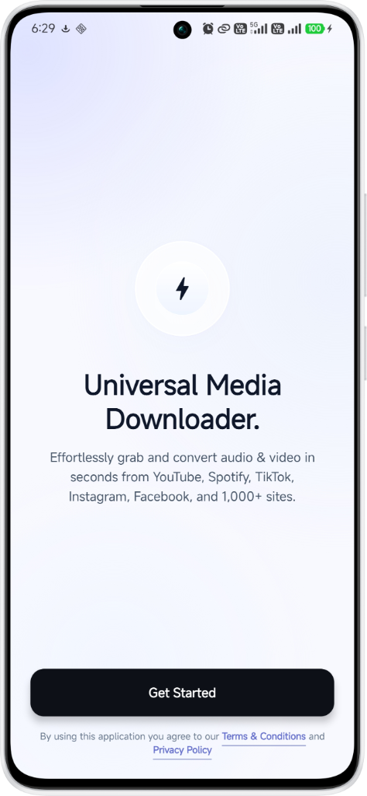
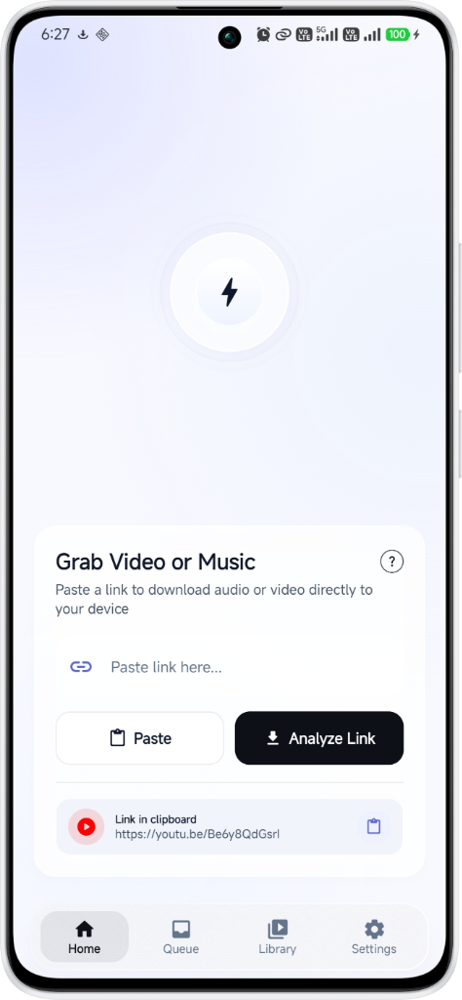
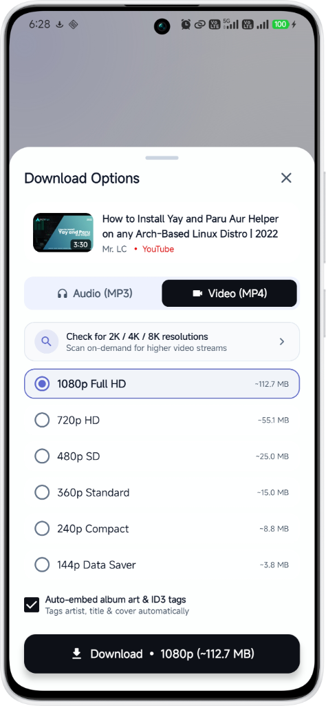
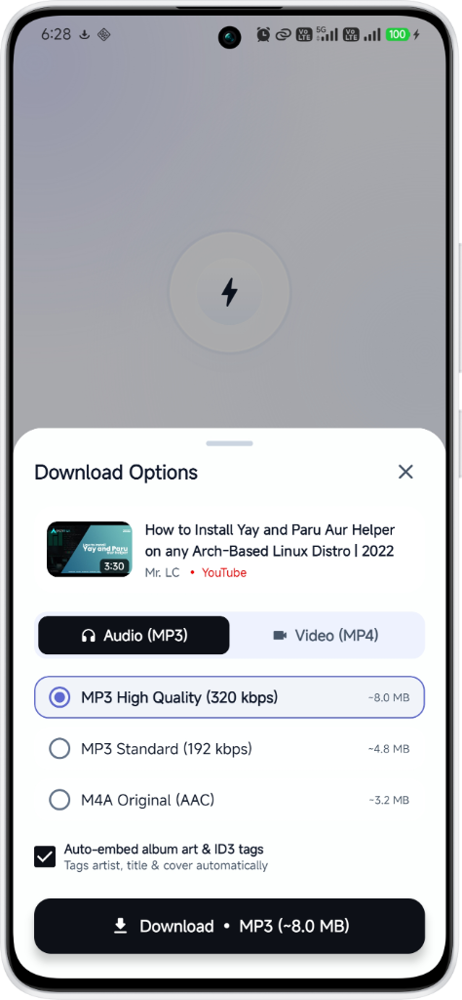
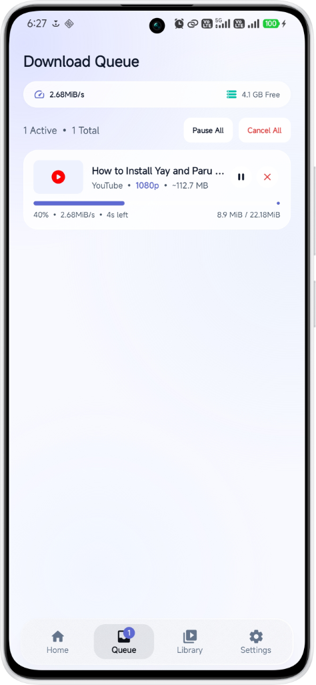
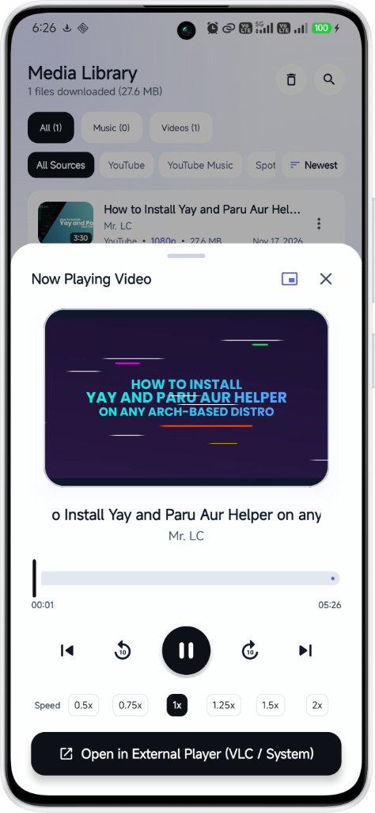
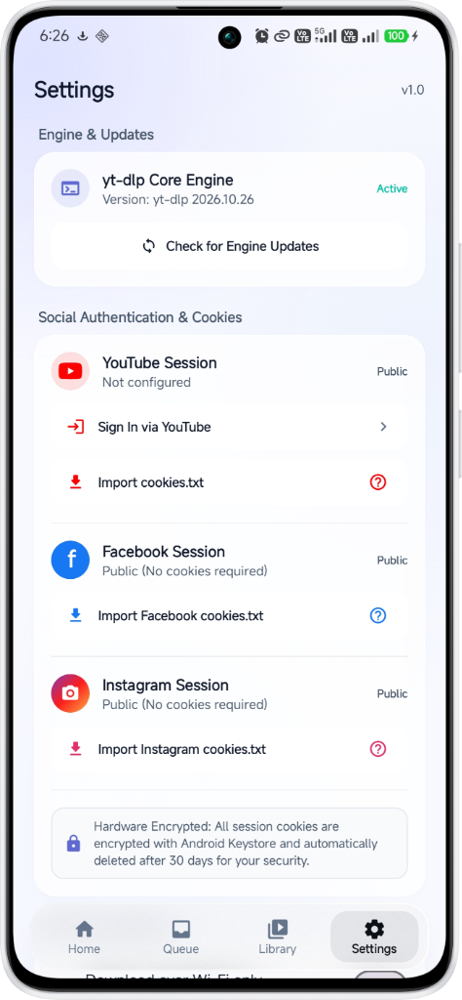

<div align="center">



# Downloader

### *Universal Media Downloader for Android*

**Effortlessly grab and convert audio & video in seconds from YouTube, Spotify, TikTok, Instagram, Facebook, and 1,000+ sites.**

[](https://github.com/leanwell/Downloader/releases)
[](LICENSE)
[](https://developer.android.com/)
[](https://developer.android.com/jetpack/compose)
[](https://kotlinlang.org/)
[](#apk-architecture-guide)

</div>

---

## Screenshots

<div align="center">

| Onboarding | Smart Home | Video Resolutions | Audio & ID3 Tags |
| :---: | :---: | :---: | :---: |
|  |  |  |  |

| Multi-Threaded Queue | In-App Media Player | Settings & Security |
| :---: | :---: | :---: |
|  |  |  |

</div>

---

## Key Features

- **1,000+ Supported Sites**: Powered by the industry-standard `yt-dlp` extraction engine. Download video and audio from YouTube, TikTok, Instagram, Facebook, Reddit, Twitter/X, SoundCloud, Vimeo, and hundreds more.
- **Aria2c Turbo Acceleration**: Built-in multi-connection download pipeline with `aria2c` for maximum speed, automatic segmenting, and connection recovery.
- **Comprehensive Resolutions (Up to 8K)**: Choose between 144p, 240p, 360p, 480p, 720p, 1080p Full HD, or run an on-demand scan for 2K, 4K, and 8K ultra-high-definition streams.
- **Studio-Grade Audio Extraction**: Convert videos into crystal-clear MP3 (up to 320 kbps) or untouched original AAC (M4A) tracks.
- **Automated ID3 Metadata & Album Art**: Automatically extracts artist names, track titles, album info, and embeds high-resolution cover art directly into the output audio file.
- **Hardware-Backed Android Keystore Encryption**: Social session cookies for YouTube, Facebook, and Instagram are encrypted locally using the hardware-backed **Android Keystore**, ensuring sensitive credentials are never stored in plain text and expire safely after 30 days.
- **Floating In-App Player (Jetpack Media3 / ExoPlayer)**: Enjoy your downloads directly inside the app with picture-in-picture (PiP), variable speed controls (0.5x to 2x), 10-second seek skips, or hand off playback to external players like VLC or MX Player with a single tap.
- **In-App Engine Updater**: If a download fails or a website alters its streaming format, navigate to **Settings &rarr; Engine & Updates** and tap **"Check for Engine Updates"** to pull the newest `yt-dlp` core fixes immediately without waiting for a full app update.

---

## Download & Installation

Grab the latest compiled APK from the [GitHub Releases](https://github.com/leanwell/Downloader/releases) page.

### APK Architecture Guide

| Package | Recommended For | Approximate Size |
| :--- | :--- | :--- |
| **`Downloader-arm64-v8a.apk`** | **Most Modern Phones** (Samsung, Pixel, Xiaomi, OnePlus, Motorola, etc. running 64-bit Android) | ~60 MB |
| **`Downloader-universal.apk`** | Works on **any** device (bundles native binaries for all CPU architectures) | ~160 MB |
| **`Downloader-armeabi-v7a.apk`** | Older 32-bit Android phones and legacy devices | ~53 MB |
| **`Downloader-x86_64.apk`** | Android emulators, Android-x86, ChromeOS tablets | ~63 MB |

> **Tip**: If you are unsure which architecture your phone uses, download **`Downloader-arm64-v8a.apk`**. Almost all Android phones produced in the last 7 years utilize 64-bit ARM processors.

---

## Tech Stack & Architecture

Downloader is engineered with a modern, reactive Kotlin stack leveraging native C/C++ cross-compilations:

- **UI & Presentation**: [Jetpack Compose](https://developer.android.com/jetpack/compose) with Material 3, enhanced with [Liquid Glass](https://github.com/Kyant0/AndroidLiquidGlass) and [Haze](https://github.com/chrisbanes/haze) frosted glass aesthetics.
- **Asynchronous Architecture**: Kotlin Coroutines, StateFlow, and SharedFlow.
- **Core Extractor**: [`yt-dlp`](https://github.com/yt-dlp/yt-dlp) running inside the native Android bridge [`io.github.junkfood02.youtubedl-android`](https://github.com/junkfood02/youtubedl-android).
- **Remuxing & Transcoding**: **[FFmpeg](https://ffmpeg.org/)** (handles dynamic video stream combining, 320 kbps MP3 conversion, and ID3 cover art embedding).
- **Multi-Threaded Downloader**: **[Aria2c](https://aria2.github.io/)** (high-performance segmented multi-connection download utility).
- **Media Playback**: [AndroidX Media3](https://developer.android.com/guide/topics/media/media3) (ExoPlayer & MediaSession architecture).
- **Image Pipeline**: [Coil](https://coil-kt.github.io/coil/) with Compose integrations.
- **Security**: Hardware-backed [Android Keystore](https://developer.android.com/privacy-and-security/keystore) provider for cryptographic storage.

---

## Frequently Asked Questions (FAQ)

<details>
<summary><b>1. Why do some links require cookies or social sign-in?</b></summary>
Platforms such as YouTube (for age-restricted content or member-only videos), Instagram, and Facebook require authenticated sessions to view or stream content. You can securely log in via the in-app YouTube WebView or import standard Netscape <code>cookies.txt</code> files in <b>Settings</b>. All session tokens are encrypted with Android Keystore hardware keys.
</details>

<details>
<summary><b>2. How does the in-app yt-dlp update work?</b></summary>
Websites frequently modify their internal video APIs and playback algorithms. In <b>Settings &rarr; Engine & Updates</b>, you can tap <b>"Check for Engine Updates"</b>. The app will fetch and unpack the latest release of <code>yt-dlp</code> dynamically, restoring broken extractors immediately without requiring you to download a new APK.
</details>

<details>
<summary><b>3. Where are downloaded files stored on my device?</b></summary>
Audio tracks are saved to your device's public <code>Music/Downloader/</code> folder, while video files are placed in <code>Movies/Downloader/</code>. You can access them immediately through any Android file manager, gallery app, or music player.
</details>

<details>
<summary><b>4. Does Downloader track or collect my personal data?</b></summary>
<b>No.</b> Downloader contains zero telemetry, zero analytics, and zero advertising trackers. The app operates completely client-side. Your browsing habits, downloads, and session cookies never leave your device.
</details>

<details>
<summary><b>5. Can I run downloads in the background?</b></summary>
Yes. Downloader runs downloads via a foreground Android service with active notification channels, allowing large queues and playlists to complete uninterrupted while you use other apps or lock your screen.
</details>

<details>
<summary><b>6. What should I do if a download fails or an extractor breaks?</b></summary>
Websites frequently update their video streaming protocols, which can temporarily cause downloads to fail. When this happens, open <b>Settings &rarr; Engine & Updates</b> and tap <b>"Check for Engine Updates"</b>. The app will fetch the latest upstream <code>yt-dlp</code> core binaries and restore downloads immediately without requiring a full APK reinstall.
</details>

---

## Building from Source

### Prerequisites
- **JDK 21** (Eclipse Temurin or OpenJDK recommended)
- **Android Studio Koala / Ladybug** or newer
- **Android SDK Platform 37**

### Build Commands

```bash
# Clone the repository
git clone https://github.com/leanwell/Downloader.git
cd Downloader

# Switch to the development branch
git checkout develop

# Build Debug APK
./gradlew assembleDebug

# Build Optimized Release APKs (produces architecture splits and universal APK)
./gradlew assembleRelease
```

Generated APKs will be located at:
```
app/build/outputs/apk/release/
```

---

## Contributing

Contributions, bug fixes, and feature ideas are warmly welcomed. Please read our [**Contributing Guide (CONTRIBUTING.md)**](CONTRIBUTING.md) to learn about our branching workflow (`develop` vs `main`), coding hygiene, and PR review process.

---

## Legal & Fair Use Disclaimer

This project is licensed under the **[GNU General Public License v3.0 (GPLv3)](LICENSE)**.

```
Copyright (C) 2026 leanwell <https://github.com/leanwell>
```

> **Disclaimer**: **Downloader** is developed exclusively for personal, educational, and fair-use archiving purposes in compliance with local copyright laws. The authors and maintainers do not host, store, or distribute any copyrighted media, nor do they endorse the unauthorized reproduction or distribution of copyrighted material. Users are solely responsible for ensuring their use of this software complies with the terms of service of the respective platforms.
